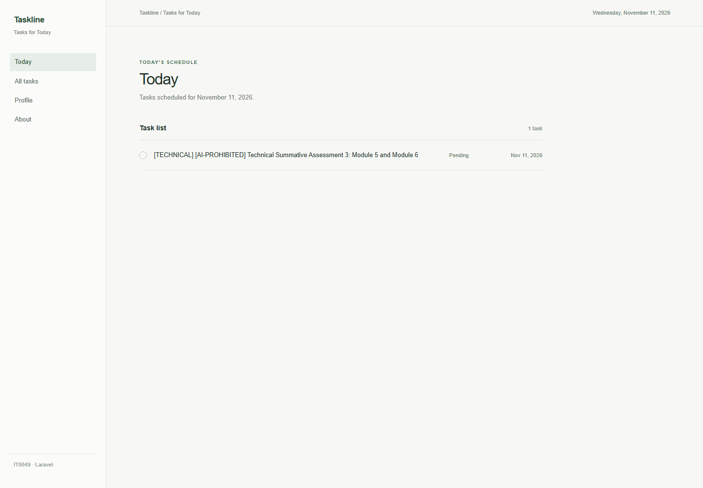
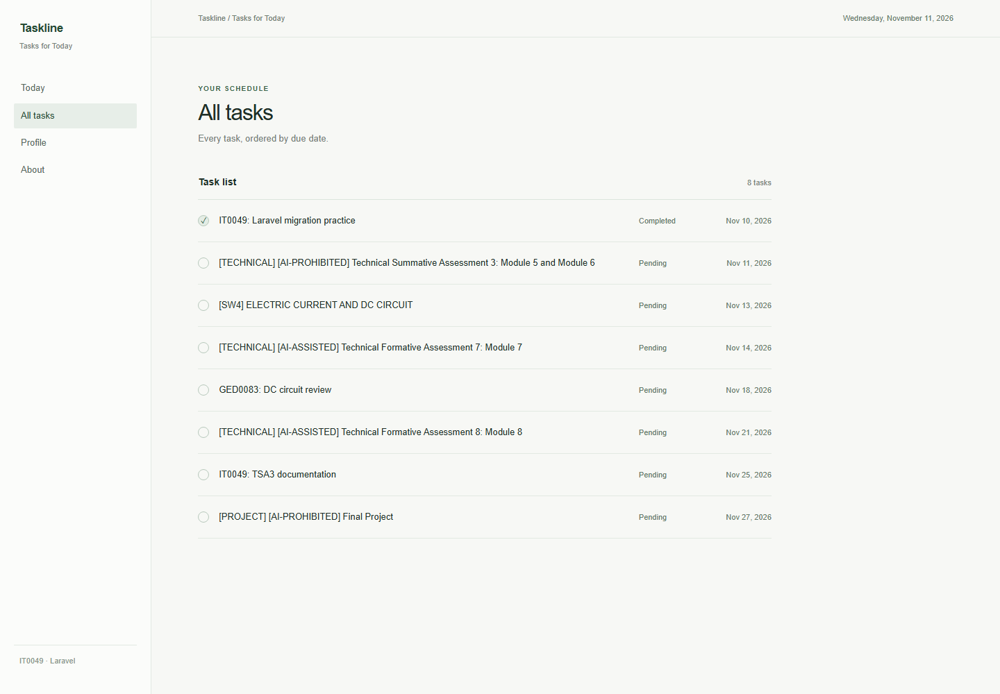
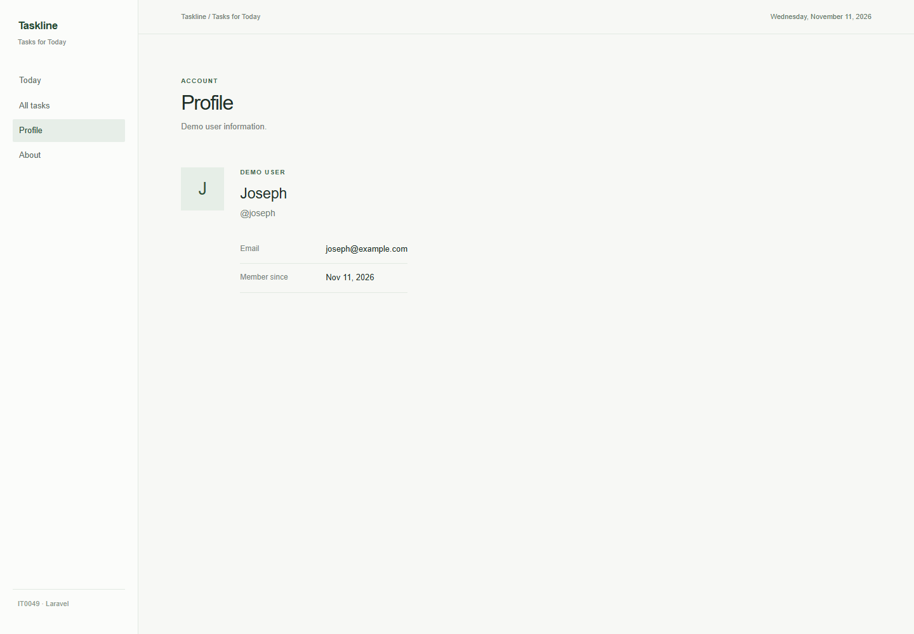
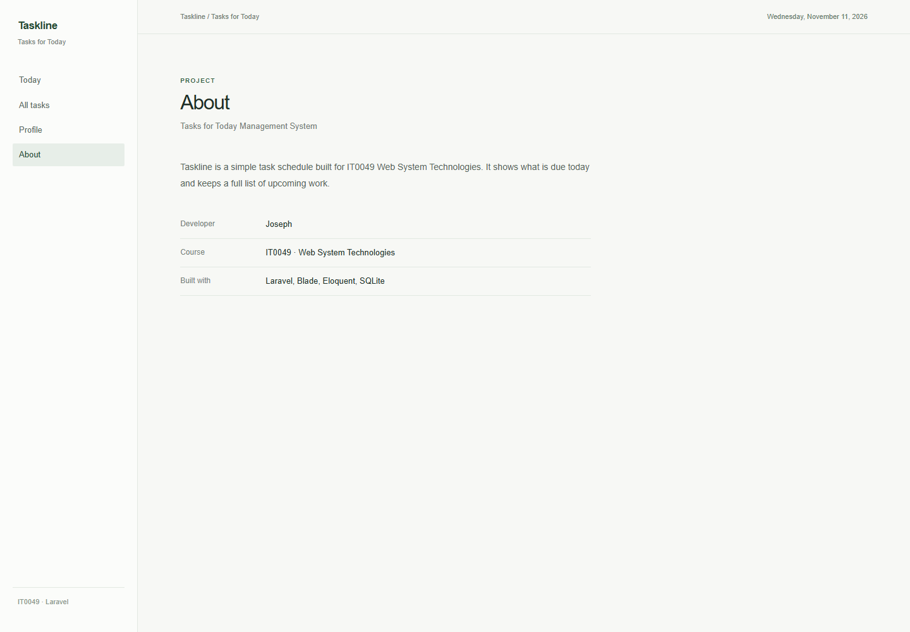

# Taskline

Taskline is a minimal Tasks for Today website built with Laravel for IT0049 TSA3. It recreates the four pages from the earlier CodeIgniter activity with Blade views and Eloquent queries.

## Pages

- `/` shows tasks due today.
- `/tasks` shows every task ordered by due date.
- `/profile` shows the single demo user.
- `/about` identifies the developer and project.

The seeded tasks include the assignments in the provided course screenshot. The first assignment is dated to the day the seeder runs, so the Today page always has a task after a fresh setup.

## Run locally

Requirements: PHP 8.3 or newer, Composer, and the PHP `pdo_sqlite` and `sqlite3` extensions.

```sh
composer install
cp .env.example .env
php artisan key:generate
php artisan migrate:fresh --seed
php artisan serve
```

Open <http://127.0.0.1:8000>. The SQLite database is `database/database.sqlite`.

On the Windows PHP installation used for this project, SQLite is available but not enabled by default. Use these commands for the migration and server instead:

```powershell
php -d extension=php_pdo_sqlite.dll -d extension=php_sqlite3.dll artisan migrate:fresh --seed
php -d extension=php_pdo_sqlite.dll -d extension=php_sqlite3.dll -S 127.0.0.1:8000 -t public
```

The migration files create the `tasks` and `users` tables. `DatabaseSeeder` inserts eight tasks across multiple dates and exactly one user. Task data is read through `Task` and `User` Eloquent models.

## Screenshots

### Today



### All tasks



### Profile



### About



## Developer

Joseph · IT0049 Web System Technologies

This repository is prepared for local use only. No hosting setup is required.
